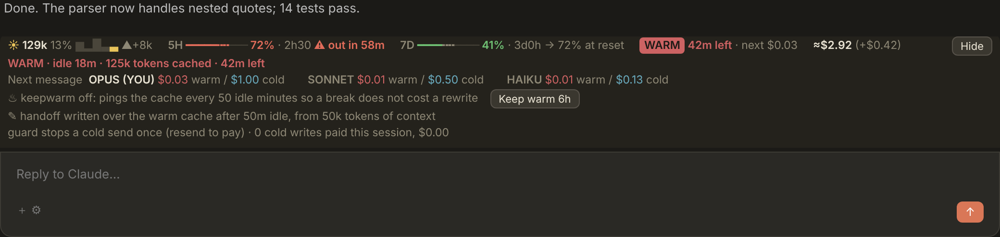
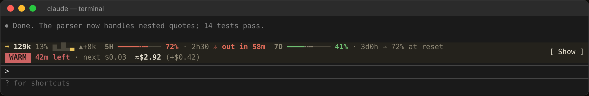

# Horizon

One band above the Claude Code prompt that combines three mods. The look is Ribbon's: a warm dark strip and a WARM/COLD chip, in compact text on the desktop. The figures are Token Weather Usage's. The prompt-cache guard and keepwarm come from Cache Tax. It also adds a handoff note, written while the cache is still cheap to read. The terminal and the desktop app get the same features.





In the terminal, one row:

```
☀ 129k 13% ▂▅▃█ ▲+8k   5H ━━━━╍╍╍─── 72% · 2h30 ⚠ out in 58m   7D ━━━╍╍───── 41% · 3d0h → 72% at reset   [ WARM ] 42m left · next $0.05 ♨ 5h12   ≈$41.07 (+$0.58 · +1.5pt 5h)   ⚙ 2 running · 7   [ Show ]
```

## Install

In Claude Code (terminal or desktop app):

```
/plugin install horizon --marketplace iLikeToLie/Horizon
```

Answer `y` to add the marketplace, pick the **user** scope, then start a new session (or run `/reload-plugins`). Needs a Claude Code version with mods (2.1.287 or later). Uninstall Ribbon, Token Weather Usage or Cache Tax first if you have them.

## What the band shows

- **Context:** the tokens in context, with a weather icon for how full the window is (☀ ☁ ☂ ☇ ↯). Then the share of the window, one bar per recent prompt, and the last prompt's change.
- **5H / 7D:** Token Weather Usage's bar. It is solid up to the share **used**; the gap to the time elapsed is dashed, in the bar's color when you are using faster than time passes and grey when you have margin. Green means behind the clock, amber ahead of it, red well ahead (15 points) or past 90% used. Then the time to reset, and where the pace so far ends up: `→ 72% at reset`, or `⚠ out in 58m` / `⚠ out Sun night` when it would run out before the reset.
- **Cache:** `WARM` with the time left and what the next message costs. Under 10 minutes it turns yellow and shows what is at stake. `COLD` appears once the 1-hour warm period is over, with how long you have been idle and the price of rewriting the cache. `♨` shows a keepwarm window and `✎ note` shows a handoff note is ready.
- **Cost:** the session cost, what the last prompt added, and the 5-hour points it used. On a subscription these are API-price equivalents, not a bill.
- **Agents:** the subagents running now and how many have run in total.

**Show / Hide** (hotkey `w`) opens a card with:

- the cache state
- the warm and cold price of the next message on Opus, Sonnet and Haiku, with yours marked `YOU`
- keepwarm, with a **Keep warm 6h** / **Stop keepwarm** button (`k`)
- the handoff note, with a **Clear and continue** button (`h`)
- the guard mode and the cold writes paid this session

The card opens by itself when the cache goes cold. In the terminal, click a button, or focus the band with ctrl+x tab and use its hotkey.

## When the cache goes cold

From 50k tokens of context, the first message you type after the 1-hour warm period is **held once** and its rewrite price is shown. Send it again to pay. Keepwarm then holds the cache for 3 hours. Or run `/handoff`. Prompts no person sent (background notifications, scheduled prompts) are sent anyway, with the price logged.

## Handoff note

After 50 idle minutes, while the cache is still warm, the mod forks the conversation once and asks for a short handoff note. That fork reads the cached prefix at the cache-read rate, so it costs cents rather than the dollars of a cold rewrite. It also refreshes the cache once. No note is written while keepwarm is on, or for contexts under 50k tokens. `/handoff` clears the conversation and puts the note in your prompt box to edit and send. `/handoff show` prints the note. `/horizon handoff off` turns it off.

## Commands

    /keepwarm               keep the cache warm for 6 hours (a ping every 50 idle minutes)
    /keepwarm 90m           a window of your own (2h30m, 6h…)
    /keepwarm always        every session, until 6 hours after its last turn
    /keepwarm status | off
    /horizon                the cache card as text
    /horizon guard warn     show the price and send, never hold
    /horizon guard refuse   hold a cold send once (default)
    /horizon handoff on|off
    /handoff [show]

Pings cost tokens: a cache read plus a one-word answer. A one-hour cache is the default on a subscription. On an API key, set `promptCacheTtl` to `"1h"`.

## Don't install it alongside

If Ribbon, Token Weather Usage or Cache Tax is also installed, you get two bands, two guards on every cold send, and possibly two keepwarm pings. The mod logs a warning if it sees Cache Tax.

## Credits and license

Apache-2.0; see `LICENSE` and `NOTICE`. Based on [Token Weather Usage](https://github.com/augiefra/claude-mods) by Eric Cologni (Apache-2.0), [Cache Tax](https://github.com/karanb192/cache-tax) by Karan Bansal (MIT) and [ribbon](https://github.com/robonuggets/ribbon) by Jay E / RoboNuggets (MIT). Prices come from Cache Tax's list-price table in `hooks/keepwarm.ts`; edit `PRICES` there when they change.

## Develop

    claude plugin validate .
    claude plugin test .
